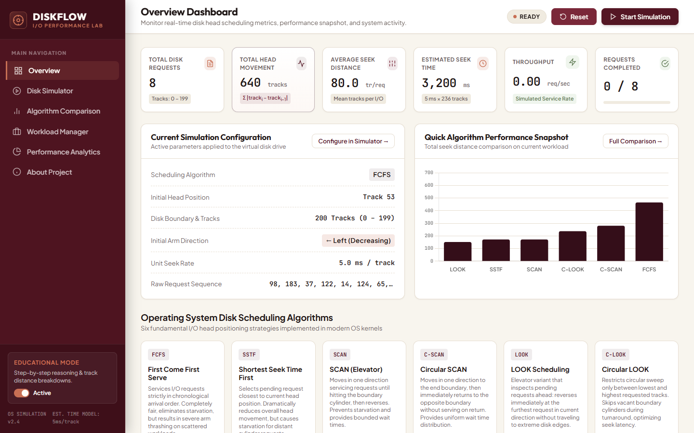
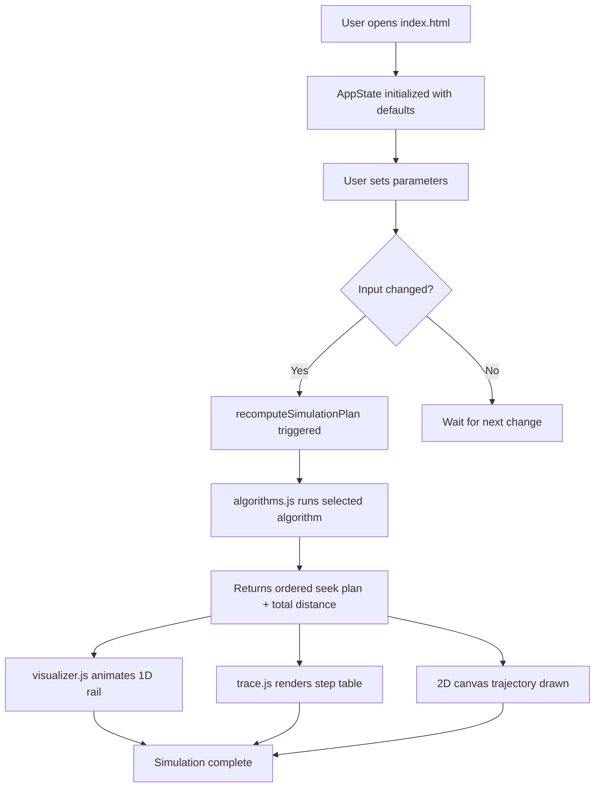
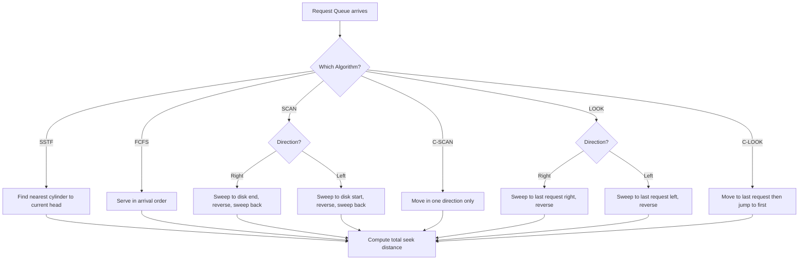
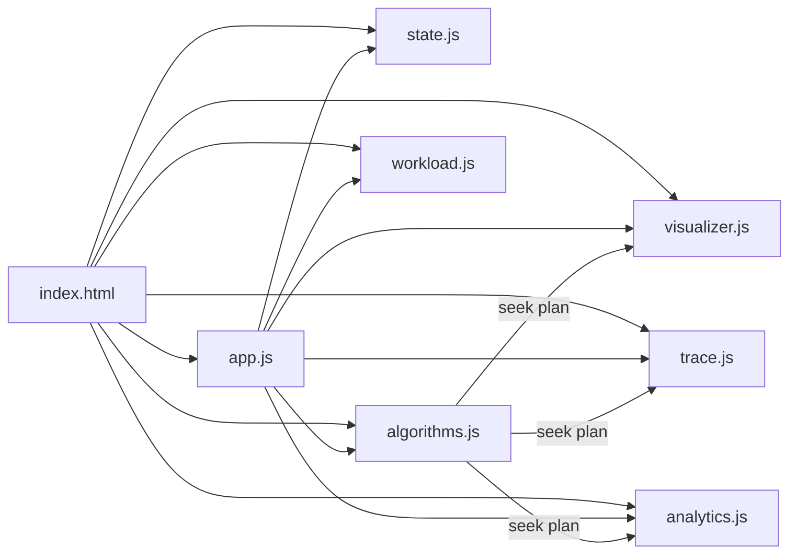

# DISKFLOW — Disk Scheduling & I/O Performance Simulator

---

## What is DISKFLOW?

DISKFLOW is an educational web-based simulator designed to help students, developers, and OS enthusiasts **understand and visualize how a computer's disk scheduling system works** — the same mechanism that determines in what order your hard drive serves read/write requests.

Modern operating systems use disk scheduling algorithms to decide the order in which I/O requests from multiple processes are served. A poor scheduling strategy results in excessive head movement, high seek time, and degraded system performance. DISKFLOW makes this abstract concept tangible by animating the disk head in real time and measuring exactly how far it travels under each algorithm.

### What problem does it solve?

When multiple programs need to read or write data at the same time, the OS must queue those requests and serve them efficiently. The order it chooses dramatically affects performance:

- **Bad scheduling** can cause the disk head to jump back and forth wildly, wasting time
- **Good scheduling** minimizes total head movement, reducing seek time and improving throughput

DISKFLOW lets you load any set of cylinder requests, choose from 6 real-world algorithms, and immediately see — with animation and hard numbers — which strategy wins and why.

### Who is it for?

- **Students** studying Operating Systems who want to go beyond textbook diagrams
- **Educators** who want a live demo tool for class
- **Developers** curious about low-level I/O performance concepts
- **Anyone** preparing for OS interviews or exams (GATE, university papers, etc.)

### What can you do with it?

- Simulate FCFS, SSTF, SCAN, C-SCAN, LOOK, and C-LOOK on any custom queue
- Watch the disk head animate across a 1D platter rail in real time
- Compare all 6 algorithms side-by-side in one chart
- Run multi-process workloads with Fair or Priority I/O scheduling
- Benchmark algorithms and see which performs best on your data
- Read a step-by-step trace table showing every head movement

---

## Preview



---

## Features

| Feature | Description |
|---|---|
| Live 1D Animation | Watch the disk head sweep across the platter rail in real time |
| 2D Seek Trajectory | Canvas-drawn seek-time vs cylinder chart for every algorithm |
| Algorithm Comparison | Side-by-side bar and radar charts across all 6 algorithms |
| Workload Manager | Simulate multi-process I/O queues with Fair / Priority scheduling |
| Analytics Dashboard | Benchmarks, seek-rate distributions, efficiency leaderboard |
| Trace Table | Step-by-step head movement log with cumulative seek times |
| Instant Reactivity | Every parameter change triggers instant re-simulation |

---

## How It Works

### Application Flow



### Algorithm Decision Logic



### Module Architecture



---

## Algorithms

| Algorithm | Full Name | Key Characteristic |
|---|---|---|
| FCFS | First Come First Served | Requests served in arrival order |
| SSTF | Shortest Seek Time First | Greedy — nearest cylinder wins |
| SCAN | Elevator Algorithm | Head sweeps end-to-end, serves en-route |
| C-SCAN | Circular SCAN | Returns to 0 after reaching end, one-directional |
| LOOK | Optimized SCAN | Reverses at last request, not disk end |
| C-LOOK | Circular LOOK | Like LOOK but jumps back after last request |

---

## Quick Start

**Option 1 — Open directly**
```bash
# Double-click index.html, or in terminal:
start index.html          # Windows
open index.html           # macOS
xdg-open index.html       # Linux
```

**Option 2 — Python local server**
```bash
cd diskflow
python -m http.server 8080
# Open: http://localhost:8080
```

**Option 3 — Node.js**
```bash
npx serve .
```

---

## File Structure

```
diskflow/
├── index.html              # Main entry point
├── assets/
│   └── preview.png         # UI preview screenshot
├── css/
│   ├── variables.css       # Design tokens — colors, fonts, spacing
│   ├── layout.css          # Sidebar, header, responsive grid
│   ├── components.css      # Buttons, cards, modals, tables
│   ├── simulator.css       # 1D platter rail, carriage, 2D canvas
│   └── views.css           # All page view styles
├── js/
│   ├── state.js            # AppState store
│   ├── algorithms.js       # FCFS, SSTF, SCAN, C-SCAN, LOOK, C-LOOK
│   ├── visualizer.js       # 1D animation + 2D canvas trajectory
│   ├── trace.js            # Trace table render
│   ├── workload.js         # Multi-process workload synthesis
│   ├── analytics.js        # Benchmarks, Chart.js, leaderboard
│   └── app.js              # Orchestrator — events, navigation
├── package.json
├── .gitignore
└── README.md
```

---

## Algorithm Verification

Default parameters: **Head = 53**, **Queue = [98, 183, 37, 122, 14, 124, 65, 67]**, **Disk = 0–199**

| Algorithm | Expected Total Seek | Reference |
|---|---|---|
| FCFS | 640 cylinders | Silberschatz Ch.10 |
| SSTF | 236 cylinders | Silberschatz Ch.10 |
| SCAN | 236 cylinders | Silberschatz Ch.10 |
| C-SCAN | 382 cylinders | Silberschatz Ch.10 |
| LOOK | 208 cylinders | Silberschatz Ch.10 |
| C-LOOK | 322 cylinders | Silberschatz Ch.10 |

---

## Tech Stack

| Library | Usage |
|---|---|
| Chart.js 4.x (CDN) | Bar and radar charts |
| Google Fonts | Outfit, Plus Jakarta Sans, JetBrains Mono |
| HTML5 Canvas | 2D seek trajectory drawing |
| Vanilla JS ES2020 | All logic, no frameworks |

---

## Contributing

1. Fork the repository
2. Create a feature branch: `git checkout -b feat/your-feature`
3. Commit your changes: `git commit -m 'feat: add some feature'`
4. Push: `git push origin feat/your-feature`
5. Open a Pull Request

---

## License

MIT License — feel free to use, modify and distribute.
